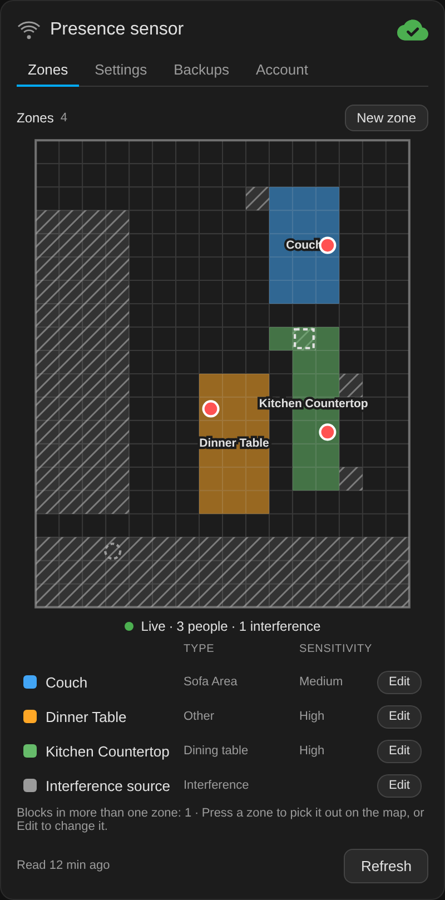
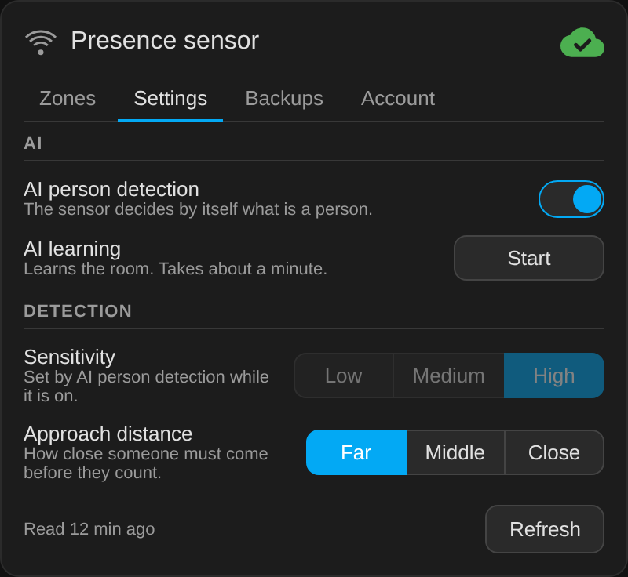

# FP2 Companion for Home Assistant

[](https://www.home-assistant.io/)
[](https://hacs.xyz/)
[](https://appdaemon.readthedocs.io/)

A Home Assistant companion for the Aqara FP2 presence sensor. It brings the
settings that otherwise live only in the Aqara phone app into Home
Assistant: sensitivity, approach distance, AI person detection, and a full
zone editor with backups, plus the live targets on the zone map, the way the
Aqara app shows them.

The FP2 reports presence to Home Assistant locally over HomeKit, but it has
no local channel for its settings, which normally means the Aqara phone app.
FP2 Companion is an [AppDaemon](https://appdaemon.readthedocs.io/) app and a
Lovelace card that make those settings available in Home Assistant through
the same cloud API the Aqara app uses. Presence keeps flowing over HomeKit
and does not depend on the cloud.

<p align="center">
  
  
</p>

> **Unofficial.** This project is not affiliated with Aqara or Lumi. It uses
> a private API that Aqara does not document or support, and that can change
> or stop working at any time. Use it at your own risk.

## Features

- **Settings as entities:** sensitivity, approach distance, the sensitivity
  of each detection zone, the AI person detection switch and the AI learning
  button, all found automatically for every FP2 paired over HomeKit.
- **Zone editor card:** paint blocks on the 16 by 20 grid, rename zones, set
  their type and sensitivity, create and delete detection zones, redraw the
  interference zone, the entrance zone and the room's edge, and change a
  zone's attribute between detection, entrance and edge.
- **Backups:** the zones are backed up whenever they change and before every
  write. Any backup can be previewed on the map and restored.
- **Live view:** the people and interference sources the FP2 is tracking,
  drawn as dots on the zone map, while the card is on screen. The FP2 itself
  is drawn where the Aqara app draws it, at the middle of the top side for a
  wall mount.
- **Sign-in from the card:** email, password and country, the same as the
  Aqara app. The password is encrypted in the browser and never stored.
- **No polling:** the app reads the cloud at startup, after every write and
  on Refresh. The live view runs only while someone is looking at it.

## Requirements

- Home Assistant with the FP2 paired through **HomeKit Device** (the
  `homekit_controller` integration). The app finds FP2s by their HomeKit
  model, `PS-S02D` or `PS-T02E`.
- The **AppDaemon** add-on (4.5 or later), with its MQTT plugin connected to
  the same broker as Home Assistant's MQTT integration.
- An **Aqara account** that owns the FP2s.
- An **admin** Home Assistant user for the live view, because it listens
  through Home Assistant's own MQTT subscription, which is open to admins
  only. Everything else works for any user.

## Installation

### 1. The app

**With HACS.** In HACS, open the integration's options and turn on
**Enable AppDaemon apps discovery & tracking**. Then add
`https://github.com/sfortis/fp2-companion` as a custom repository of the
type **AppDaemon** and download FP2 Companion. HACS puts the app under
`appdaemon/apps/` in Home Assistant's configuration folder, while the
AppDaemon add-on on Home Assistant OS reads its apps from its own folder by
default. Once the download has created that folder, point the add-on at it
in its `appdaemon.yaml` (`/addon_configs/a0d7b954_appdaemon/appdaemon.yaml`)
and restart the add-on:

```yaml
appdaemon:
  app_dir: /homeassistant/appdaemon/apps
```

Set it only after the download: the add-on may not start while the folder
does not exist yet. The setting moves the apps folder for every app, so move
any apps you already have into it as well.

**By hand.** Copy `apps/fp2_companion/` into AppDaemon's apps folder. On
Home Assistant OS that is `/addon_configs/a0d7b954_appdaemon/apps/`.

The app's settings are in `fp2_companion.yaml` beside it, and the defaults
suit most homes.

### 2. The card

The card ships with the app, so HACS installs and updates both. When the app
starts it copies the card into Home Assistant's `www` folder and adds the
dashboard resource for it, and after an update it changes the resource's
`?v=` so browsers load the new card. A resource for the card that you added
by hand is moved to the new copy rather than doubled. Add the card to a
dashboard:

```yaml
type: custom:fp2-companion-card
```

| Option | Default | Meaning |
|---|---|---|
| `title` | `Presence sensor` | The card's title |
| `device` | none | Pins the card to one FP2, by its serial, entity prefix, device id or name, and hides the device picker |
| `devices_entity` | `sensor.fp2_companion_devices` | The app's own sensor |
| `command_root` | `fp2companion` | The app's MQTT prefix |
| `entities` | `{}` | Overrides for entity ids renamed in the registry, on a pinned card |
| `text` | English | Every word on the card, for a translation |

The card sends its commands to the app over MQTT. At startup the app checks
that they reach it, and subscribes to its command topics itself when your
`client_topics` list in `appdaemon.yaml` leaves them out. When something
stops either step, the AppDaemon log says what to do by hand.

### 3. Sign in

Open the card and sign in with your Aqara account and its country. The app
creates its own session and keeps it alive by itself; the token is renewed
before it expires, and the password is not needed again.
`apps/fp2_companion/tools/login.py` does the same sign-in from the command line.

## Using It

The card has four tabs.

- **Zones** shows the map, the live dots and the legend. Press a zone to
  pick it out on the map, or **Edit** to change it. Editing paints blocks by
  tapping or dragging. **Delete** needs a second press.
- **Settings** has AI person detection, sensitivity, approach distance and
  AI learning. While AI person detection is on, the sensor sets its own
  sensitivity and ignores changes to it, so the control is disabled.
- **Backups** lists the zone backups. Choosing one previews it on the map,
  and **Restore** needs a second press.
- **Account** shows the Aqara account, until when the session is valid,
  **Change login** and **Log out**, which needs a second press.

The cloud icon at the top shows the app's status: green with a check when
all is well, amber with an exclamation mark for a warning, and red with a
cross when there is no session. The line under it explains anything that is
not green.

## Live View

The live view runs only while the card's map is on screen, and stops when
the card is scrolled away or the screen goes off. Nothing it shows is written
to Home Assistant's recorder. [docs/DESIGN.md](docs/DESIGN.md) explains how
it works.

## Known Limits

- The dots and the FP2 on the map use the placement for a wall-mounted FP2.
  A ceiling mount has not been checked.
- Accounts in the China region (CN) cannot sign in with the built-in Aqara
  app identity. Such an account needs a working pair of its own, as
  `aqara_app_id` and `aqara_app_key` in the add-on's `secrets.yaml`, with
  `app_id` and `app_key` uncommented in `fp2_companion.yaml`.
- The card installs its own dashboard resource only when Home Assistant runs
  with a Supervisor (Home Assistant OS or Supervised) and the resources are
  managed in the UI. Otherwise the AppDaemon log names the resource to add.
- A zone changes its attribute only from or to detection. To turn an
  entrance zone into the edge, make it a detection zone first.

## Security and Privacy

- The password is turned into its MD5 and encrypted with Aqara's public RSA
  key in the browser, as the Aqara app does, and only that block crosses
  Home Assistant and MQTT. The app uses it once and keeps only the token.
- The session lives in `/share/appdaemon/fp2_companion/session.json` with mode
  0600. Nothing in the app logs a token, a user id or the app key.
- The app writes only a fixed list of settings and values, and refuses
  anything else before it reaches the network.
- Zone backups are in `/share/appdaemon/fp2_companion/backups/<device id>/`.
- The app uses the add-on's Supervisor token for one thing only: to read the
  dashboard resources and create or update the card's own.

## Entities

For an FP2 whose HomeKit entities start with `presence_sensor_fp2_b2c3`, the
app creates `select.presence_sensor_fp2_b2c3_sensitivity`,
`..._approach_distance`, one `..._<zone>_sensitivity` per detection zone,
`switch...._ai_detection`, `button...._ai_learning`, `button...._refresh`,
`sensor...._zones`, `sensor...._backup_preview` and
`sensor...._cloud_status`, on a device of its own in the FP2's area. It also
creates `sensor.fp2_companion_devices`, which lists every FP2 it serves.

## Development

```
python3 -m pytest tests
NODE_PATH="$(npm root -g)" node tests/card/fp2-companion-smoke.js
```

The Python tests need only `pytest`. The card test needs `jsdom` installed
globally, and Python's `cryptography` for its RSA check.
`tests/card/fp2-companion-render.js` renders the card from a live Home Assistant
into an HTML file, for a look in a headless browser. `scripts/deploy.sh`
deploys to a Home Assistant OS host over SSH.

[docs/DESIGN.md](docs/DESIGN.md) explains how the app is built and why, and
[docs/PROTOCOL.md](docs/PROTOCOL.md) describes the cloud API it uses.

## Credits

The region to host table and the first map of the API came from
[Aqara-LANLink](https://github.com/absent42/Aqara-LANLink) by Dan Gibson
(MIT).

## License

MIT, see [LICENSE](LICENSE).
