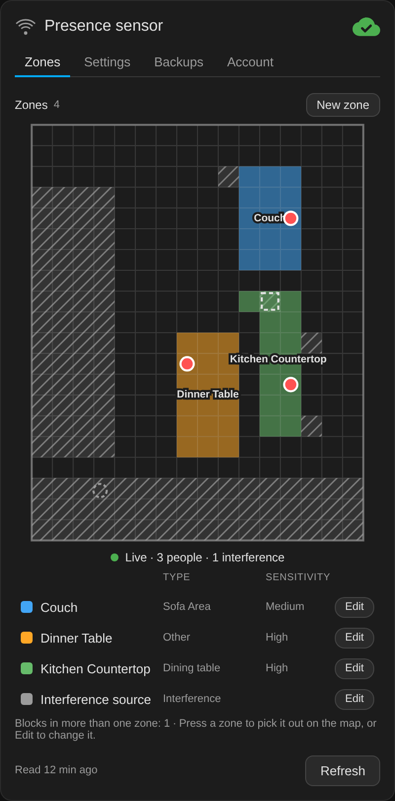
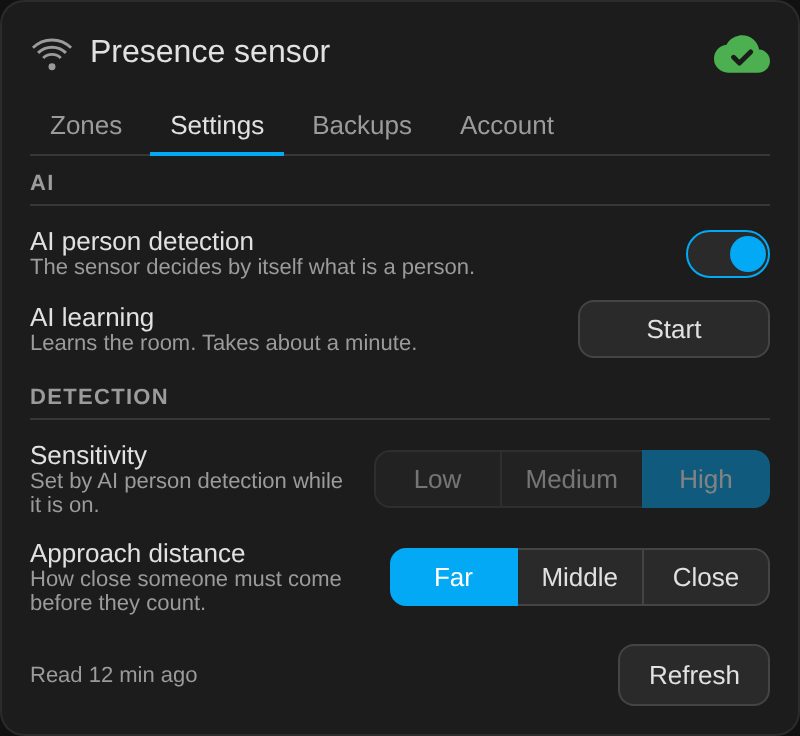

# Aqara FP2 Companion

[](https://www.home-assistant.io/)
[](https://hacs.xyz/)

A Home Assistant companion for the Aqara FP2 presence sensor. It brings the
settings that otherwise live only in the Aqara phone app into Home
Assistant: sensitivity, approach distance, AI person detection, and a full
zone editor with backups, plus the live targets on the zone map, the way the
Aqara app shows them. It is an unofficial project and is not made by or
affiliated with Aqara.

The FP2 reports presence to Home Assistant locally over HomeKit, but it has
no local channel for its settings, which normally means the Aqara phone app.
FP2 Companion is a Home Assistant integration and a
[Lovelace card](https://github.com/sfortis/fp2-companion-card) that make
those settings available in Home Assistant through
the same cloud API the Aqara app uses. Presence keeps flowing over HomeKit
and does not depend on the cloud.

## Requirements

- Home Assistant with the FP2 paired through **HomeKit Device** (the
  `homekit_controller` integration). The integration finds FP2s by their
  HomeKit model, `PS-S02D`, `PS-S02E` or `PS-T02E`.
- An MQTT broker, such as the Mosquitto app, with Home Assistant's
  **MQTT** integration connected to it.
- The [FP2 Companion Card](https://github.com/sfortis/fp2-companion-card),
  installed from HACS. The card is the integration's user interface.
- An **Aqara account** that owns the FP2s.
- An **admin** Home Assistant user for the live view, because it listens
  through Home Assistant's own MQTT subscription, which is open to admins
  only. Everything else works for any user.

<p align="center">
  
  
</p>

> **Unofficial.** This project is not affiliated with Aqara or Lumi. It uses
> a private API that Aqara does not document or support, and that can change
> or stop working at any time. Use it at your own risk.

## Features

- **Settings as entities:** sensitivity, approach distance, the sensitivity
  of each detection zone, the AI person detection switch and the AI learning
  button, all found automatically for every FP2 paired over HomeKit.
- **Zone editor card:** paint blocks on the 16 by 20 grid, rename zones, set
  their type and sensitivity, create and delete detection zones, redraw the
  interference zone, the entrance zone and the room's edge, and change a
  zone's attribute between detection, entrance and edge.
- **Backups:** the zones are backed up whenever they change and before every
  write. Any backup can be previewed on the map and restored.
- **Live view:** the people and interference sources the FP2 is tracking,
  drawn as dots on the zone map, while the card is on screen. The FP2 itself
  is drawn where the Aqara app draws it, at the middle of the top side for a
  wall mount.
- **Sign-in from the card:** email, password and country, the same as the
  Aqara app. The password is encrypted in the browser and never stored.
- **No polling:** the integration reads the cloud at startup, after every write and
  on Refresh. The live view runs only while someone is looking at it.

## Installation

### 1. The integration

**With HACS.** Search for **FP2 Companion** in HACS (the Marketplace since
Home Assistant 2026.11) and download it. If the search does not find it yet,
add `https://github.com/sfortis/fp2-companion` as a custom repository of the
type **Integration** instead. Restart Home Assistant, then add
**FP2 Companion** in **Settings > Devices & services**.

**By hand.** Copy `custom_components/fp2_companion/` into the
`custom_components` folder of Home Assistant's configuration folder, restart
Home Assistant and add the integration as above.

There is nothing to fill in when adding it: the FP2s are found by
themselves. Its options take extra FP2s that are not paired over HomeKit,
FP2s to leave alone, the number of zone backups to keep and the time of the
daily token check.

**Moving from the AppDaemon app (1.4.1 and earlier).** HACS no longer
manages AppDaemon apps since Home Assistant 2026.11, and the app and the
integration must not run side by side: both would refresh the same Aqara
session and sign each other out. So:

1. Stop the app: stop AppDaemon, or remove the `fp2_companion` entry from
   AppDaemon's `apps.yaml` (if you added one) and restart it. Then delete
   the app's folder: `appdaemon/apps/fp2-companion/` in Home Assistant's
   configuration folder when HACS installed it, or the `fp2_companion/`
   folder you copied by hand. (The integration cannot tell whether AppDaemon
   unloads an app when its folder disappears, hence this order.)
2. Install and add the integration as above. Its first start copies the
   session and the zone backups from `/share/appdaemon/fp2_companion/`, so
   you stay signed in and keep every backup, and then deletes the old
   `session.json` there, so no second valid token is left behind. A file
   that is already in the new place is never overwritten. The entities, their ids and
   the card stay as they were.
3. Settings you had in `fp2_companion.yaml` (`devices`, `exclude`,
   `backups_keep`, `token_check_time`) go into the integration's options.

While the app's folder is still there, the integration does not start and
raises a repair that says so; it starts by itself once the folder is gone.
It can see the folder only where HACS put it. If you copied the app by hand
into the AppDaemon app's own folder
(`/addon_configs/a0d7b954_appdaemon/apps/`), remove it from there yourself
first.

### 2. The card

The card is its own HACS repository,
[FP2 Companion Card](https://github.com/sfortis/fp2-companion-card). In HACS,
search for **FP2 Companion Card** and download it. If the search does not
find it yet, add `https://github.com/sfortis/fp2-companion-card` as a custom
repository of the type **Dashboard** instead. HACS adds its dashboard
resource and updates it. Then add the card to a dashboard:

```yaml
type: custom:fp2-companion-card
```

Its options are in the card's README.

**Updating from version 1.3.1 or earlier.** Those versions copied the card
into Home Assistant's `www/fp2-companion/` folder and added a dashboard
resource for it themselves. The integration does neither, so that copy
stops receiving updates. Install the card from HACS, then delete the
resource whose URL starts with `/local/fp2-companion/` and the folder
`www/fp2-companion/`. A resource you added for the card by hand goes too.
Home Assistant's log reminds you while the folder is still there. The
[card's README](https://github.com/sfortis/fp2-companion-card#moving-from-the-card-the-app-installed)
has the steps.

The card sends its commands to the integration over MQTT, which receives
them through Home Assistant's own MQTT connection.

### 3. Sign in

Open the card and sign in with your Aqara account and its country. The
integration creates its own session and keeps it alive by itself; the token
is renewed before it expires, and the password is not needed again.
`custom_components/fp2_companion/tools/login.py` does the same sign-in from
the command line.

## Using It

The card has four tabs: **Zones**, **Settings**, **Backups** and
**Account**. The
[card's README](https://github.com/sfortis/fp2-companion-card#using-it)
describes each one.

## Live View

The live view runs only while the card's map is on screen, and stops when
the card is scrolled away or the screen goes off. Nothing it shows is written
to Home Assistant's recorder. [docs/DESIGN.md](docs/DESIGN.md) explains how
it works.

## Known Limits

- The dots and the FP2 on the map use the placement for a wall-mounted FP2.
  A ceiling mount has not been checked.
- Accounts in the China region (CN) cannot sign in with the built-in Aqara
  app identity. Such an account needs a working pair of its own, as
  `app_id:app_key` in the integration's options; `tools/login.py` reads the
  pair from `secrets.yaml` (`aqara_app_id`, `aqara_app_key`) or, if there is
  none, from the options.
- A zone changes its attribute only from or to detection. To turn an
  entrance zone into the edge, make it a detection zone first.

## Security and Privacy

- The password is turned into its MD5 and encrypted with Aqara's public RSA
  key in the browser, as the Aqara app does, and only that block crosses
  Home Assistant and MQTT. The integration uses it once and keeps only the
  token.
- The session lives in `.storage/fp2_companion/session.json` in Home
  Assistant's configuration folder, with mode 0600. Nothing in the
  integration logs a token, a user id or the app key.
- The integration writes only a fixed list of settings and values, and refuses
  anything else before it reaches the network.
- Zone backups are in `.storage/fp2_companion/backups/<device id>/`.
- The integration writes nothing outside its own state folder, apart from
  its MQTT messages.

## Entities

For an FP2 whose HomeKit entities start with `presence_sensor_fp2_b2c3`, the
integration creates `select.presence_sensor_fp2_b2c3_sensitivity`,
`..._approach_distance`, one `..._<zone>_sensitivity` per detection zone,
`switch...._ai_detection`, `button...._ai_learning`, `button...._refresh`,
`sensor...._zones`, `sensor...._backup_preview` and
`sensor...._cloud_status`, on a device of its own in the FP2's area. It also
creates `sensor.fp2_companion_devices`, which lists every FP2 it serves.

## Development

```
python3 -m pytest tests
python3 -m pytest -c tests_ha/pytest.ini tests_ha
```

`tests` covers the app logic and the cloud client and needs only `pytest`.
`tests_ha` runs the integration inside Home Assistant and needs
`pytest-homeassistant-custom-component` (Python 3.14 for current Home
Assistant). The card and its tests are in the
[card's repository](https://github.com/sfortis/fp2-companion-card).
`scripts/deploy.sh` deploys the integration to a Home Assistant OS host over
SSH.

[docs/DESIGN.md](docs/DESIGN.md) explains how it is built and why, and
[docs/PROTOCOL.md](docs/PROTOCOL.md) describes the cloud API it uses.

## Credits

The region to host table and the first map of the API came from
[Aqara-LANLink](https://github.com/absent42/Aqara-LANLink) by Dan Gibson
(MIT).

## License

MIT, see [LICENSE](LICENSE).
